# Warden

**A desktop merge request reviewer that runs on your own Claude Code subscription.**

Warden watches your GitLab merge requests, checks each one out locally, runs your CI and a set of
deterministic checks, asks your local [Claude Code](https://claude.com/claude-code) CLI to review the
change, and shows you the findings to approve before anything is posted back as line comments.

No API key and no per-token billing: reviews go through the `claude` CLI you are already logged in
to, so they count against your Claude subscription. Claude can only read the MR through Warden's own
tools. It never gets a forge token and cannot post anything; only Warden posts, and only what passes
your guardrails.

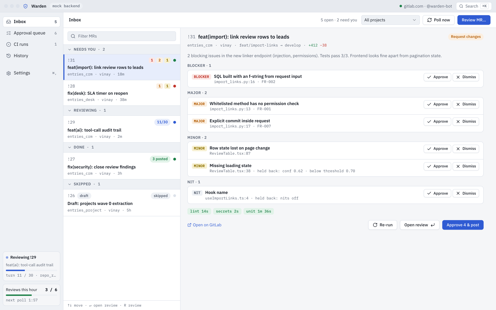

## Features

- **Inbox:** every open MR across your projects, grouped by what needs you, with a preview of
  Claude's verdict and findings. Approve and post from the preview, or open the full review.
- **One finding at a time:** go through findings with the keyboard (`A` approve, `E` edit,
  `D` dismiss, `U` undo), each shown with its code and suggested fix. The Diff tab shows findings as
  comment threads under their lines, the way they will look on GitLab.
- **Approval queue:** every pending finding from every MR in one list, with bulk approve and dismiss,
  and a preview of each note exactly as it will be posted.
- **Local CI:** runs the recipes from `.warden.yml` (ruff, pytest, bench run-tests, eslint, semgrep,
  gitleaks, gitlab-ci-local...) in an isolated git worktree. Failing tests are parsed out of the log
  with a link to the line in the review.
- **Guardrails:** findings must point at a changed line, clear a confidence and severity floor, fit a
  note budget, and not repeat an open thread. Secrets are redacted. A live preview shows which recent
  findings would post, wait for approval or be dropped as you change a setting.
- **Custom rules in the app:** add your own rules per project: a plain-English instruction for
  Claude, a regex run on added lines, or a semgrep file. Test a pattern on pasted code or on a recent
  MR's diff before saving, change the severity or scope of built-in and `.warden.yml` rules, add
  review instructions, and copy your rules as a `.warden.yml` block to commit for the team.
- **Posting modes:** Draft (you approve every note), Assist (confident blockers and majors post on
  their own) or Auto.
- **Add projects in two clicks:** Warden lists the projects your token can see and finds your existing
  clones by matching git remotes, or keeps its own copy. Paste an MR link to add its project and start
  a review straight away.
- **History:** every run, tool call, guardrail decision and post, with weekly numbers.
- **Command palette** (`⌘K`), a separate Settings window (`⌘,`), menu-bar tray, light and dark mode.

## Screenshots

| | |
|---|---|
| 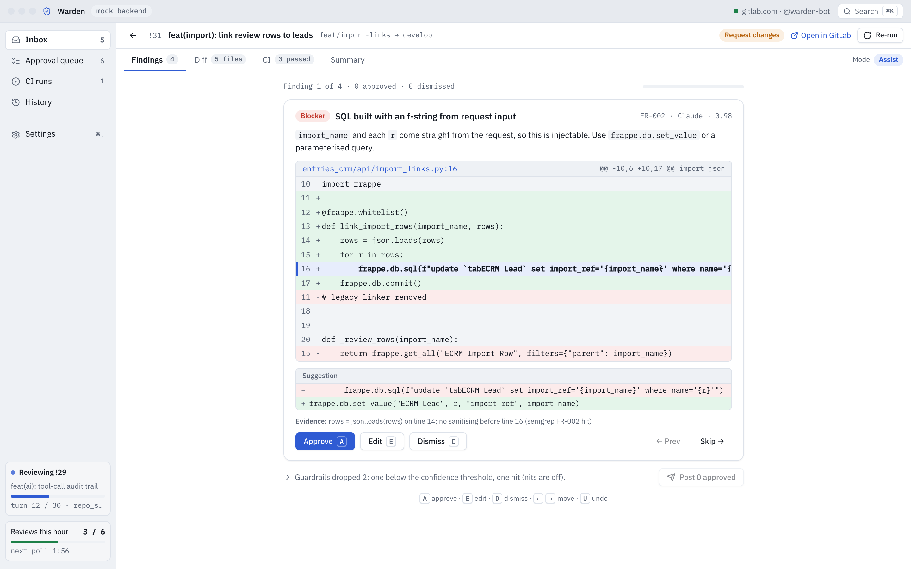 | 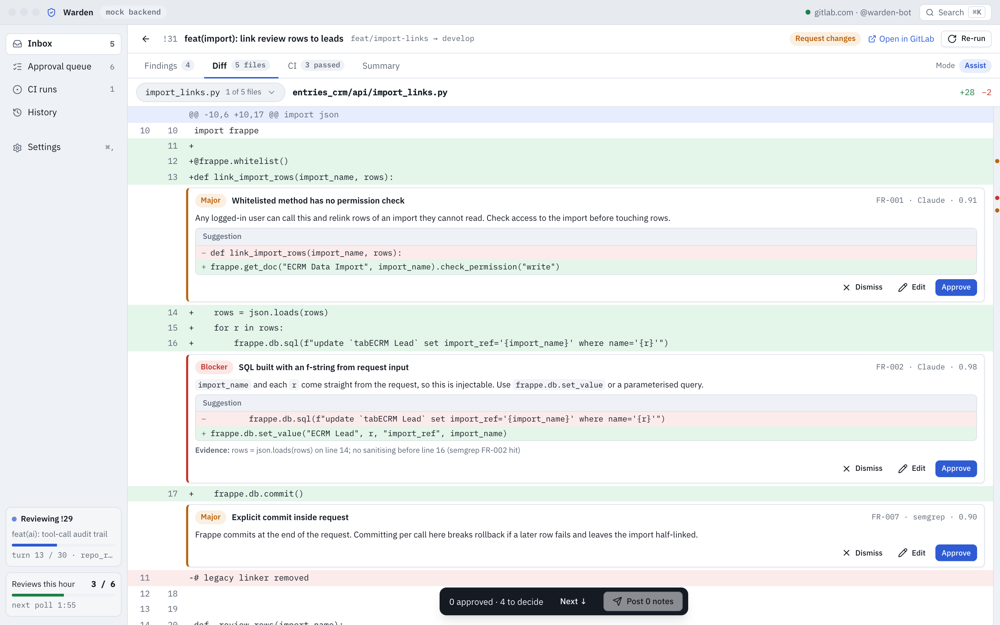 |
| **Review:** one finding at a time | **Diff:** findings inline, as on GitLab |
| 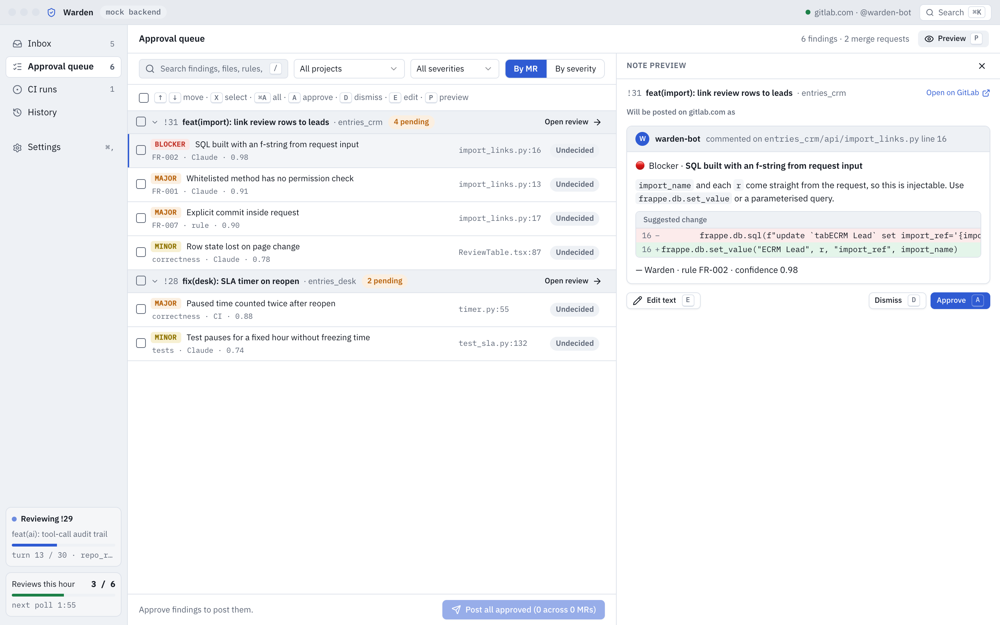 | 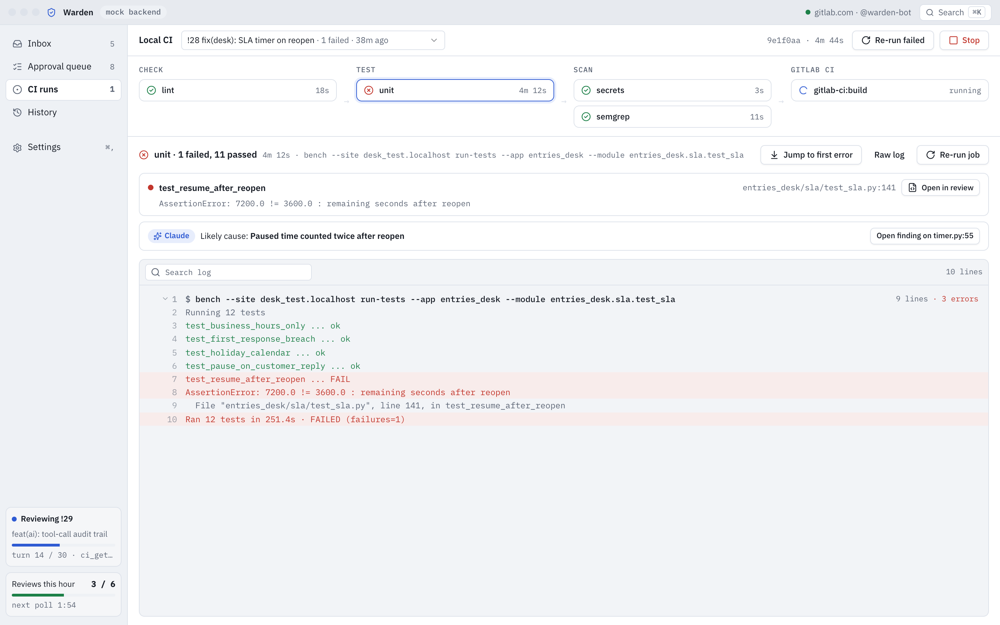 |
| **Approval queue** with note preview | **Local CI** with parsed failures |
| 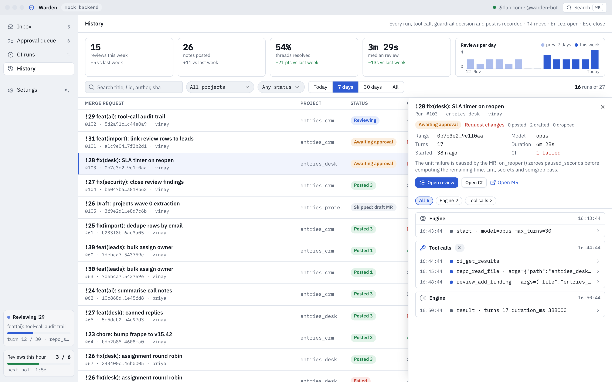 | 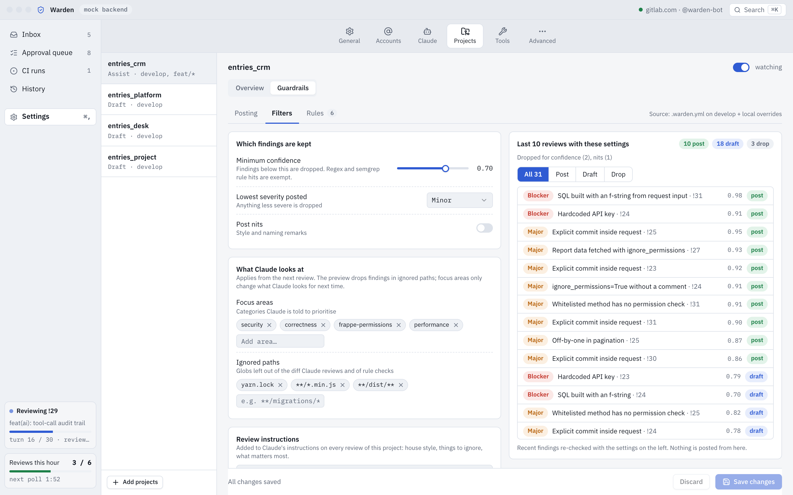 |
| **History** and audit trail | **Guardrails** with live preview |
| 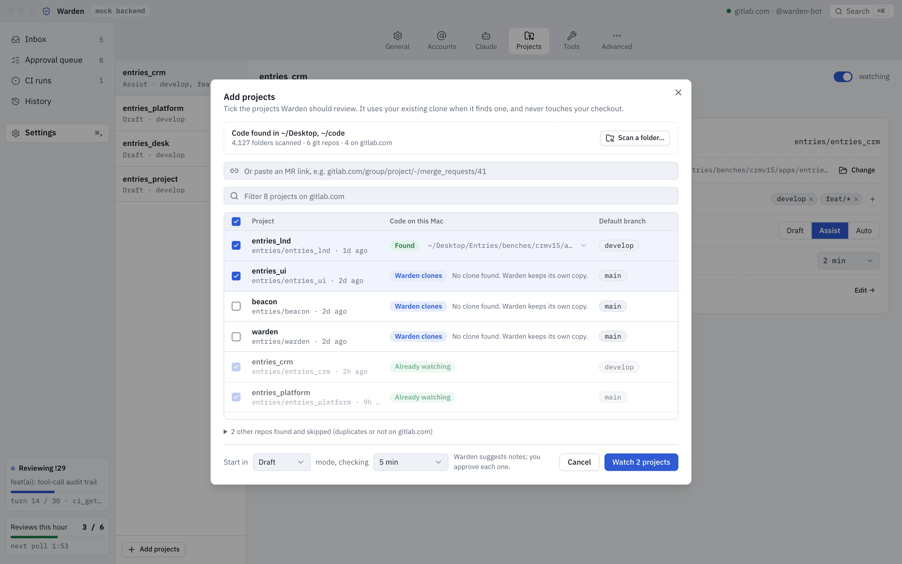 | 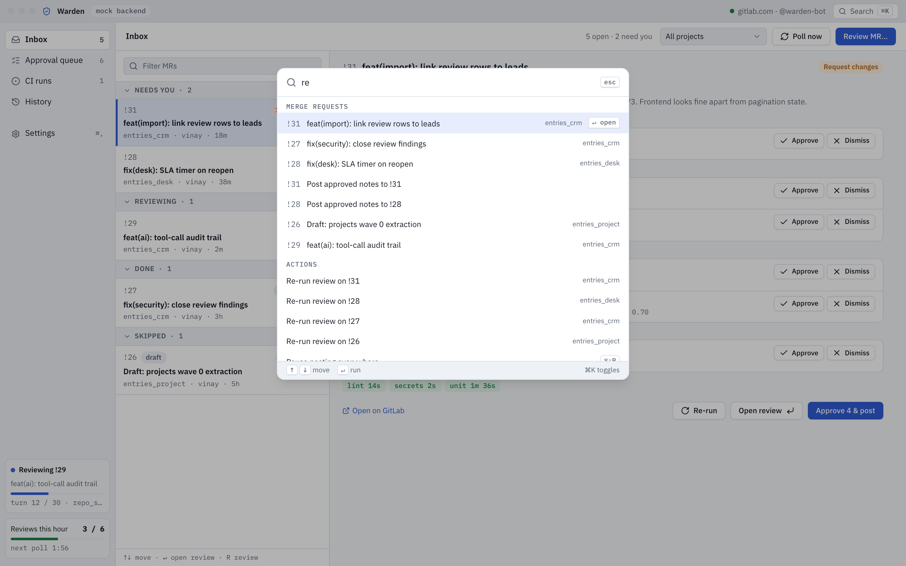 |
| **Add projects** from your clones | **Command palette** |
| 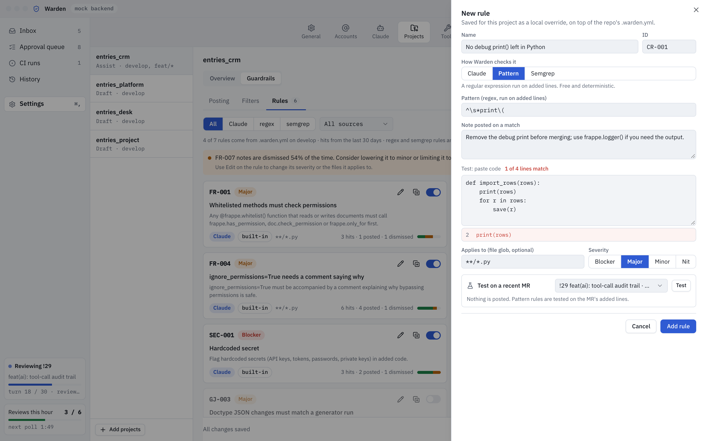 | 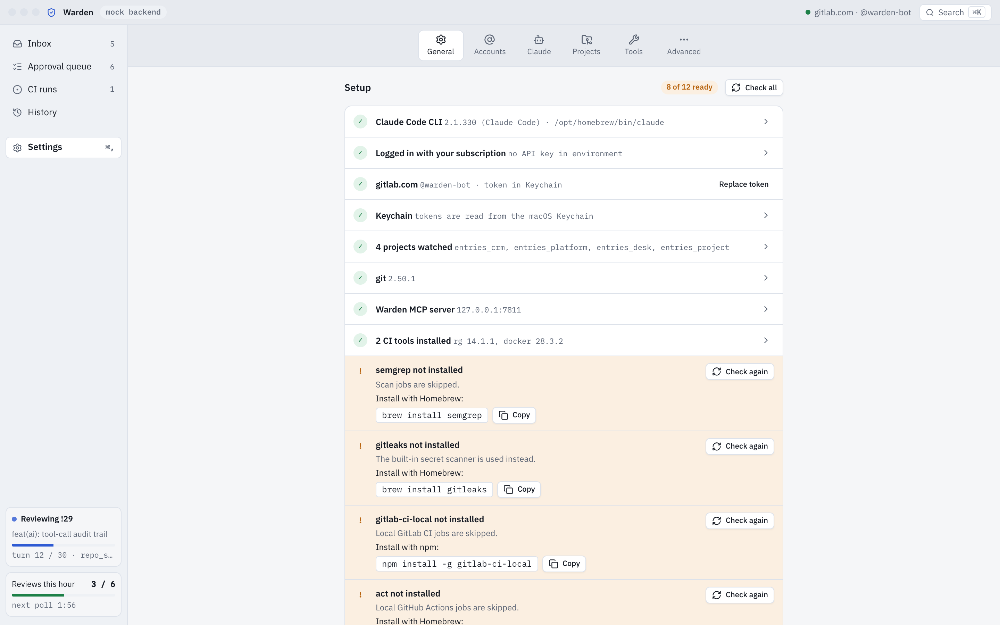 |
| **Custom rules** with a live test | **Settings:** setup checklist |
| 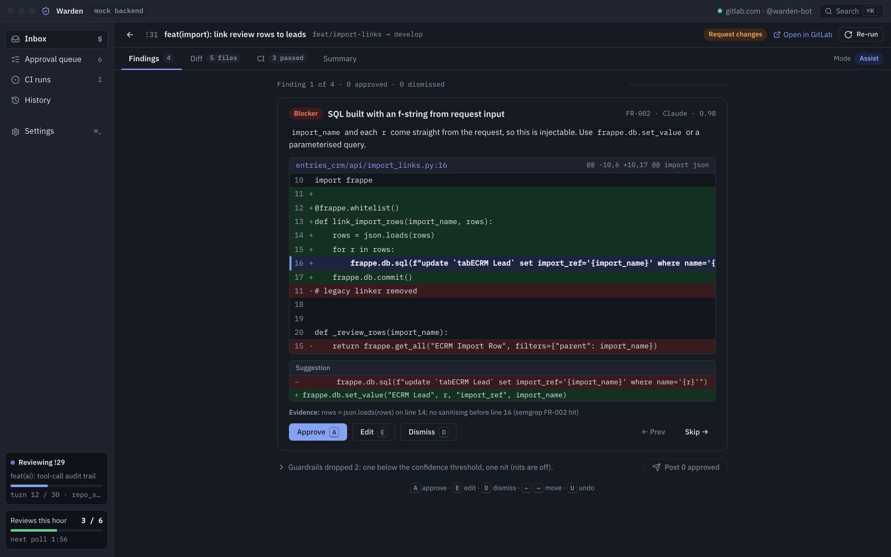 | 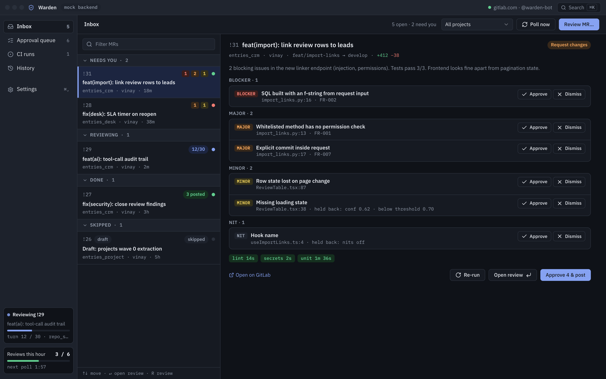 |
| **Dark mode** | **Inbox** in dark mode |

Screenshots use the built-in sample data.

## How it works

```
GitLab ──poll──▶ Warden ──git worktree──▶ local checkout of the MR
                   │
                   ├─ deterministic checks (regex rules, secret scan, semgrep)
                   ├─ local CI recipes (.warden.yml)
                   ├─ claude -p  ◀──MCP (127.0.0.1)──▶  Warden tools: read diff, read file,
                   │                                     CI results, add finding
                   ├─ guardrails (anchor, confidence, severity, budget, dedupe, redaction)
                   └─ you approve ──▶ Warden posts line notes to the MR
```

- The review runs as `claude -p ... --strict-mcp-config --allowedTools mcp__warden__*`. Claude's
  built-in file, shell and web tools are disabled, so it can only see what Warden's MCP tools return.
- `ANTHROPIC_API_KEY` and similar variables are removed from the child process, so the CLI uses your
  subscription login.
- `.warden.yml` is read from the MR's **target** branch, so an MR cannot change the rules or CI
  commands used to review itself.
- Tokens live only in the macOS Keychain.

## Requirements

- macOS 13 or later (Apple silicon or Intel)
- [Claude Code](https://claude.com/claude-code) installed and logged in with a Claude subscription
  (`claude` on your `PATH`; run `claude` once and sign in)
- `git`
- A GitLab personal access token with the `api` scope (gitlab.com or self-hosted)
- Optional, used when installed: `semgrep`, `gitleaks`, `gitlab-ci-local`, `docker`

GitHub support is partial: reading PRs and posting comments work, resolving threads does not yet.

## Install

Download `Warden_<version>_aarch64.dmg` from the
[latest release](https://github.com/vineyrawat/warden/releases/latest), open it and drag Warden to
Applications.

The app is not notarized yet. The first time, right-click Warden in Applications and choose **Open**,
or run:

```bash
xattr -dr com.apple.quarantine /Applications/Warden.app
```

## Set up

1. **Open Warden.** Settings → General shows a checklist: Claude CLI found and logged in, forge
   connected, Keychain, git and the optional tools. Anything missing comes with the exact command to fix it.
2. **Connect GitLab.** Settings → Accounts → Connect, enter your GitLab URL (for example
   `https://gitlab.com`) and paste the token. Warden checks it and stores it in the Keychain.
3. **Add projects.** Settings → Projects → Add projects. Tick the projects to watch. Warden uses your
   existing clone when it finds one (it scans `~/Desktop`, `~/code`, `~/Projects` and similar, or a
   folder you pick) and otherwise keeps its own copy. New projects start in **Draft** mode.
4. **Review.** Open MRs show up in the Inbox and are reviewed automatically (6 reviews per hour by
   default, set in Settings → Claude). Go through the findings, approve what you agree with, and post.

## Custom rules and guardrails

Settings → Projects → (project) → Guardrails:

- **Posting:** posting mode, which severities may post on their own, note budget, summary note.
- **Filters:** minimum confidence, lowest severity, nits, focus areas, ignored paths, and
  **review instructions** (free text added to every review, e.g. house style or what to ignore).
  A live preview shows what your last reviews would have posted with these settings.
- **Rules:** every rule with its 30-day hits and how often its notes were dismissed.
  **New rule** opens an editor:
  - **Claude:** an instruction Claude checks on every review ("user-facing strings must be wrapped
    in `_()`").
  - **Pattern:** a regex run on added lines, with the note text to post. Paste code to see which
    lines match, or test it on a recent MR's diff. Nothing is posted while testing.
  - **Semgrep:** a rules file in the repo, run when semgrep is installed.
  - File glob and severity for each rule. Built-in and `.warden.yml` rules can have their severity
    and file scope changed locally; **Reset** restores them.

Custom rules are stored per project on your Mac and get IDs like `CR-001`. **Copy as .warden.yml**
puts them on the clipboard as a `rules:` block so you can commit them for your team.

## Configure a repository

Add a `.warden.yml` to the repository root (on the target branch). Everything is optional.

```yaml
version: 1
review:
  focus: [security, correctness, performance]
  ignore_paths: ["yarn.lock", "**/*.min.js", "**/dist/**"]
  max_notes: 10
  min_confidence: 0.7
  severity_floor: minor          # blocker | major | minor | nit
  nits: false
  extra_instructions: ""         # appended to the review prompt
rules:
  - id: FR-001
    title: Whitelisted methods must check permissions
    applies_to: "**/*.py"
    instruction: "Every @frappe.whitelist() method must call frappe.has_permission or check roles."
    severity: major              # instruction = checked by Claude
  - id: FR-002
    title: No string-formatted SQL
    pattern: 'frappe\.db\.sql\(\s*f["'']'
    severity: blocker            # pattern = regex over added lines
ci:
  recipes:
    - name: lint
      run: "ruff check {changed_py}"
      timeout: "5m"
    - name: unit
      run: "bench --site test_site run-tests --app my_app"
      timeout: "15m"
posting:
  mode: assist                   # draft | assist | auto
  auto_post: { severities: [blocker, major], min_confidence: 0.85 }
  summary_note: true
  max_notes_per_hour: 30
```

Placeholders in `run`: `{changed_files}`, `{changed_py}`, `{changed_ts}`, `{base_sha}`, `{head_sha}`.
Without a `.warden.yml`, Warden uses a built-in rule set (permission checks, string-formatted SQL,
`ignore_permissions`, commits inside requests, hardcoded secrets). Per-project overrides can be set in
Settings → Projects → Guardrails.

Label an MR `no-ai-review` to skip it. Draft MRs are skipped.

## Build from source

Prerequisites: Rust (stable), Node.js 20+, pnpm, Xcode command line tools.

```bash
git clone https://github.com/vineyrawat/warden.git
```

```bash
cd warden && pnpm install && pnpm --dir ui install
```

```bash
pnpm tauri dev
```

```bash
pnpm tauri build
```

The release build lands in `target/release/bundle/` (`.app` and `.dmg`).

The UI also runs in a normal browser with a mock backend and sample data, which is handy for UI work:

```bash
pnpm --dir ui dev
```

Tests:

```bash
cargo test --workspace && pnpm --dir ui exec vitest run
```

`cargo test -p warden-core` also regenerates the TypeScript bindings in `ui/src/bindings/`.

### Smoke tests

```bash
# Review two local branches with the real Claude CLI (no forge involved)
cargo run -p warden-core --example review_local -- --repo /path/to/repo --base main --head my-branch

# Read-only checks against a real GitLab, using the token saved by the app.
# Writes to the forge are blocked, so nothing is posted.
cargo run -p warden-core --example live_discover -- https://gitlab.example.com
cargo run -p warden-core --example live_mr_review -- --base https://gitlab.example.com --project group/repo --managed
```

## Project layout

| Path | What it is |
|---|---|
| `crates/warden-core/` | Rust core: forge clients, diff parser, checks, guardrails, worktrees, CI runner, MCP server, review engine, poster, SQLite storage, project discovery |
| `src-tauri/` | Tauri 2 app: commands, background poller and review queue, tray, Settings window |
| `ui/` | React 18 + TypeScript + Tailwind + shadcn/ui; `ui/src/lib/mock.ts` is the browser mock backend |
| `docs/` | Design notes, UI variants and screenshots |
| `SPEC.md` | Module contracts and architecture |

App data lives in `~/Library/Application Support/Warden` (database, CI logs, `logs/warden.log`).
Closing the window keeps Warden running in the menu-bar tray.

## Developer

**Vinay Rawat**

- GitHub: [@vineyrawat](https://github.com/vineyrawat)
- Email: vineyrawat@yahoo.com

Issues and pull requests are welcome.

## License

[MIT](LICENSE) © 2026 Vinay Rawat
